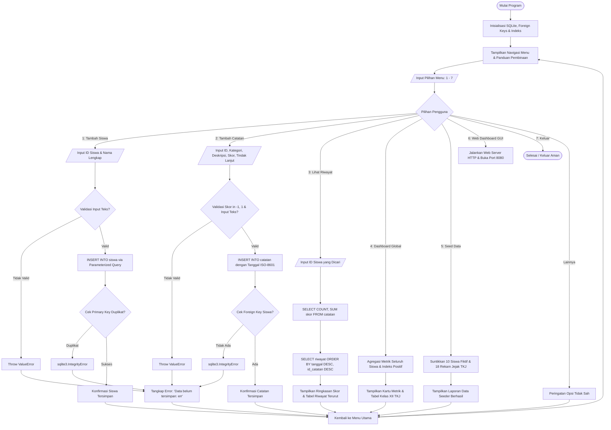
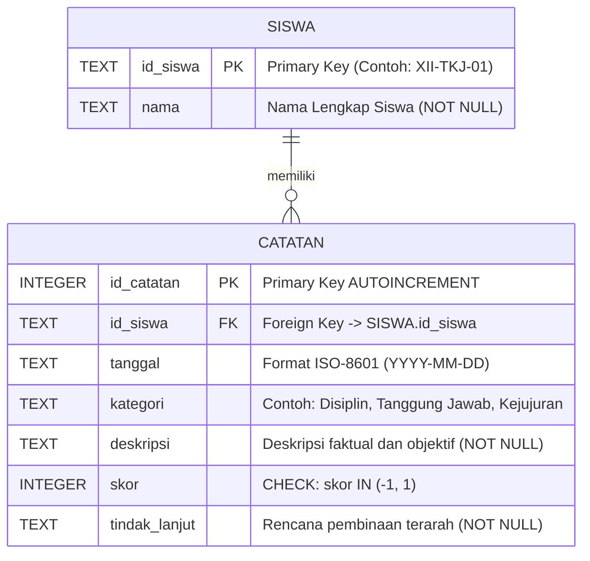

# Aplikasi Monitoring Akhlak Siswa (Kelas XII TKJ - SMK Alhadiid)

Sistem pencatatan, pemantauan, dan pembinaan karakter siswa berbasis Python murni (*Zero External Dependencies*) yang dirancang khusus untuk program keahlian Teknik Komputer dan Jaringan (TKJ) SMK Alhadiid.

Aplikasi ini mengusung arsitektur multi-interface terintegrasi:
1. **Desktop GUI Native Window (`gui_app.py`)**: Antarmuka aplikasi desktop mandiri berbasis Tkinter/ttk dengan palet warna dark modern Zinc, kartu KPI metrik, layout dual-pane responsif, pencarian langsung (*real-time search*), dan dialog pop-up validatif.
2. **Web Dashboard GUI SPA (`server_web.py`)**: Antarmuka berbasis peramban (*web browser*) dengan desain *Anti-AI Slop* modern (dark mode zinc-950, Vercel/Linear aesthetic, Lucide icons, analitik distribusi kategori akhlak, live search filter, modal form interaktif, ekspor JSON, dan layout cetak laporan resmi ber-kop surat).
3. **Terminal Technical Dashboard (`monitoring_akhlak.py`)**: Antarmuka konsol modern berbasis ANSI 256 colors dan Unicode box-drawing yang kompatibel langsung di Spyder IDE maupun terminal Linux/macOS/Windows.
4. **Unified Interactive Launcher (`main.py`)**: Menu pusat peluncuran aplikasi yang memungkinkan pengguna memilih mode operasional (Aplikasi Desktop, Web Browser, Terminal Console, Seeder, atau Pengujian Otomatis) saat pertama kali dijalankan.

Basis data menggunakan mesin relasional **SQLite3** dengan penegakan integritas ketat (*Foreign Key & CHECK constraints*), indeks optimasi kueri, dan sanitasi *parameterized queries* (`?`) untuk menangkal celah injeksi SQL (*SQL Injection*).

---

## 🎯 Tujuan Pembelajaran & Nilai Proyek

Proyek ini dirancang untuk memenuhi standar kompetensi kejuruan Kelas XII TKJ dalam bidang pemrograman sistem, rekayasa data dasar, dan tata kelola etika teknologi:
1. **Pemrograman Python Robust & Zero-Dependency**: Berjalan seketika menggunakan modul standar bawaan Python (`sqlite3`, `datetime`, `http.server`, `json`, `urllib`).
2. **Integritas Basis Data Relasional**: Menerapkan relasi *One-to-Many* (1 Siswa -> Banyak Catatan Pembinaan), pencegahan anomali data, dan eliminasi risiko data yatim (*orphaned records*).
3. **Optimasi Performa Kueri**: Penambahan indeks pada kunci asing (`idx_catatan_id_siswa`) dan kolom waktu (`idx_catatan_tanggal`).
4. **Keamanan & Validasi Berlapis**: Sanitasi input berbasis *parameterized query* (`?`) dan validasi tipe defensif.
5. **Etika & Tata Kelola Pembinaan**: Menerapkan pencatatan berbasis fakta objektif, apresiasi capaian positif (+1), evaluasi pembinaan (-1), dan pendokumentasian rencana tindak lanjut kolaboratif.

---

## 🧭 Prinsip Desain Pembinaan Siswa

Sistem ini didesain sebagai instrumen pendampingan perkembangan karakter yang berkeadilan:
1. **Mencatat Fakta yang Dapat Diamati**: Deskripsi perilaku wajib mencatat tindakan konkret yang teramati secara langsung (*observable behavior*), bukan penilaian subjektif atau pelabelan moral sepihak.
2. **Bahasa Netral & Profesional**: Menghindari kata-kata bernuansa menghakimi atau merendahkan martabat siswa.
3. **Ruang Klarifikasi & Tindak Lanjut**: Setiap catatan wajib disertai rencana aksi pembinaan yang terarah serta memberi ruang bagi siswa untuk berdialog.
4. **Skor Bukan Penentu Tunggal**: Skor `-1` (evaluasi/pembinaan) dan `+1` (apresiasi positif) hanya berfungsi sebagai indikator tren bimbingan pendidik, bukan penentu tunggal karakter apalagi nilai akademik rapor.

---

## 📊 Diagram Alur Sistem (Flowchart)



---

## 🗄️ Diagram Relasi Entitas (ERD)



---

## 🚀 Panduan Eksekusi

Aplikasi ini menggunakan pustaka standar Python 3, sehingga **tidak membutuhkan `pip install` paket eksternal apapun**.

### 1. Eksekusi Cepat Langsung (All-in-One Auto-Launch)
Cukup jalankan satu perintah:
```bash
python3 monitoring_akhlak.py
```
**Apa yang terjadi secara otomatis:**
1. Basis data SQLite diinisialisasi dan Foreign Key ditegakkan.
2. Web Dashboard GUI Enterprise otomatis aktif di background pada port `8080`.
3. Peramban web (*browser*) otomatis terbuka menampilkan antarmuka modern.
4. Terminal konsol tetap aktif melayani menu interaktif TUI.

### 2. Peluncuran Utama Interaktif (Unified Launcher)
```bash
python3 main.py
```
Menu akan meminta Anda memilih mode operasional:
- Tekan `1` untuk membuka **Aplikasi Desktop GUI (Native Window)**.
- Tekan `2` untuk membuka **Web Dashboard GUI (Browser)**.
- Tekan `3` untuk membuka **Terminal Technical Console (TUI)**.
- Tekan `4` untuk menyuntikkan **Data Seeder Simulasi (10 Siswa XII TKJ)**.
- Tekan `5` untuk menjalankan **Otomatisasi Pengujian (6 Skenario)**.

### 3. Menjalankan Langsung Mode Spesifik (CLI Flags)
```bash
# Mode Desktop GUI Native Window
python3 main.py --gui
# atau
python3 gui_app.py

# Mode Web Dashboard Browser (Port 8080)
python3 main.py --web
# atau
python3 server_web.py

# Mode Terminal Console (Spyder / Terminal)
python3 main.py --cli

# Jalankan Otomatisasi Pengujian
python3 uji_skenario.py
```

---

## 📁 Struktur Direktori Proyek

```text
monitoring-akhlak-siswa-tkj/
├── .gitignore               # Proteksi database (*.db), cache, dan file sensitif
├── DOKUMENTASI_PROYEK.md    # Laporan 5 fase proyek, etika data, & 5 jawaban refleksi
├── README.md                # Dokumentasi arsitektur, panduan teknis, dan diagram
├── gui_app.py               # Aplikasi Desktop GUI Native (Tkinter/ttk Dark Modern)
├── main.py                  # Unified interactive launcher & command router
├── monitoring_akhlak.py     # Modul inti SQLite, analitik global, seeder, & CLI dashboard
├── server_web.py            # Web Dashboard GUI SPA & REST API server (Zero Dependency)
└── uji_skenario.py          # Otomatisasi pengujian 6 skenario wajib & verifikasi
```

---

## 🛡️ Lisensi & Hak Cipta
Modul Proyek Praktik Kejuruan Kelas XII TKJ - SMK Alhadiid. Dikembangkan untuk tujuan edukasi, penguatan karakter siswa, dan keunggulan rekayasa perangkat lunak.
