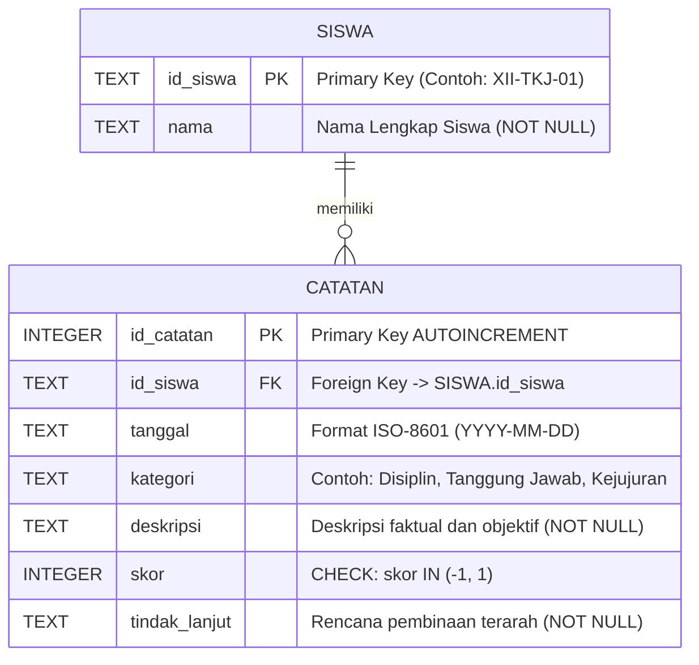

# Aplikasi Monitoring Akhlak Siswa (Kelas XII TKJ - SMK Alhadiid)

Sistem pencatatan, pemantauan, dan pembinaan karakter siswa berbasis Python murni (*Zero External Dependencies*) yang dirancang khusus untuk program keahlian Teknik Komputer dan Jaringan (TKJ) SMK Alhadiid.

Aplikasi ini mengusung arsitektur ganda:
1. **Terminal Technical Dashboard (TUI)**: Antarmuka konsol modern berbasis ANSI 256 colors dan Unicode box-drawing yang kompatibel langsung di Spyder IDE maupun terminal Linux/macOS/Windows.
2. **Web Dashboard GUI (Single-Page Application)**: Antarmuka berbasis peramban (*web browser*) dengan desain *Anti-AI Slop* modern (dark mode zinc-950, Vercel/Linear aesthetic, Lucide icons, live search filter, modal form interaktif, dan ekspor JSON) yang digerakkan langsung oleh server HTTP pustaka standar Python.

Basis data menggunakan mesin relasional **SQLite3** dengan penegakan integritas ketat (*Foreign Key & CHECK constraints*), indeks optimasi kueri, dan sanitasi *parameterized queries* (`?`) untuk menangkal celah injeksi SQL (*SQL Injection*).

---

## 🎯 Tujuan Pembelajaran & Nilai Proyek

Proyek ini dirancang untuk memenuhi standar kompetensi kejuruan Kelas XII TKJ dalam bidang pemrograman sistem, rekayasa data dasar, dan tata kelola etika teknologi:
1. **Pemrograman Python Robust & Zero-Dependency**: Berjalan seketika menggunakan modul standar bawaan Python (`sqlite3`, `datetime`, `http.server`, `json`, `urllib`).
2. **Integritas Basis Data Relasional**: Menerapkan relasi *One-to-Many* (1 Siswa -> Banyak Catatan Pembinaan), pencegahan anomali data, dan eliminasi risiko data yatim (*orphaned records*).
3. **Optimasi Performa Kueri**: Penambahan indeks pada kunci asing (`idx_catatan_id_siswa`) dan kolom waktu (`idx_catatan_tanggal`).
4. **Keamanan & Validasi Berlapis**: Sanitasi input berbasis *parameterized query* (`?`) dan validasi tipe defensif.
5. **Etika & Tata Kelola Pembinaan**: Menerapkan pencatatan berbasis fakta objektif, apresiasi capaian positif (+1), evaluasi pembinaan (-1), dan pendokumentasian rencana tindak lanjut kolaboratif.

---

## 🧭 Prinsip Desain Pembinaan Siswa

Sistem ini didesain sebagai instrumen pendampingan perkembangan karakter yang berkeadilan:
1. **Mencatat Fakta yang Dapat Diamati**: Deskripsi perilaku wajib mencatat tindakan konkret yang teramati secara langsung (*observable behavior*), bukan penilaian subjektif atau pelabelan moral sepihak.
2. **Bahasa Netral & Profesional**: Menghindari kata-kata bernuansa menghakimi atau merendahkan martabat siswa.
3. **Ruang Klarifikasi & Tindak Lanjut**: Setiap catatan wajib disertai rencana aksi pembinaan yang terarah serta memberi ruang bagi siswa untuk berdialog.
4. **Skor Bukan Penentu Tunggal**: Skor `-1` (evaluasi/pembinaan) dan `+1` (apresiasi positif) hanya berfungsi sebagai indikator tren bimbingan pendidik, bukan penentu tunggal karakter apalagi nilai akademik rapor.

---

## 📊 Diagram Alur Sistem (Flowchart)


---

## 🗄️ Diagram Relasi Entitas (ERD)



---

## 🚀 Panduan Eksekusi

Aplikasi ini menggunakan pustaka standar Python 3, sehingga **tidak membutuhkan `pip install` paket eksternal apapun**.

### 1. Menjalankan di Terminal (CLI Technical Dashboard)
```bash
# Berpindah ke direktori proyek
cd /path/ke/monitoring-akhlak-siswa-tkj

# Jalankan CLI interaktif
python3 monitoring_akhlak.py
```

### 2. Menjalankan Web Dashboard GUI (Browser)
Aplikasi menyediakan antarmuka web modern kelas enterprise:
```bash
# Jalankan web server (default port 8080)
python3 server_web.py

# Atau jalankan via flag CLI:
python3 monitoring_akhlak.py --web
```
Buka peramban (*browser*) Anda di: `http://localhost:8080`

**Fitur Web Dashboard:**
- Tampilan Dark Mode (Vercel/Linear Aesthetic).
- Metrik Real-time (Total Siswa, Total Catatan, Apresiasi Positif, Evaluasi Pembinaan).
- Pencarian dan filter instan pada daftar siswa.
- Drawer / Modal Riwayat Siswa terurut kronologis dengan status pembinaan.
- Formulir pendaftaran siswa baru & pencatatan perilaku dengan validasi instan.
- Tombol *One-Click Data Seeder* (10 siswa simulatif Kelas XII TKJ).
- Ekspor seluruh data pembinaan ke format JSON resmi.

### 3. Menjalankan di Spyder IDE
1. Buka aplikasi **Spyder**.
2. Pilih menu `File` -> `Open...`, lalu pilih `monitoring_akhlak.py`.
3. Tekan **F5** (Run File). Menu CLI interaktif akan langsung berjalan di panel **IPython Console**.

### 4. Menjalankan Otomatisasi Pengujian 6 Skenario Wajib
```bash
python3 uji_skenario.py
```
Skrip uji akan memvalidasi seluruh fungsi, kendala integritas basis data (*Primary Key*, *Foreign Key*, *CHECK constraint*), dan membersihkan database simulasi secara otomatis.

---

## 📁 Struktur Direktori Proyek

```text
monitoring-akhlak-siswa-tkj/
├── .gitignore               # Proteksi database (*.db), cache, dan file sensitif
├── DOKUMENTASI_PROYEK.md    # Laporan 5 fase proyek, etika data, & 5 jawaban refleksi
├── README.md                # Dokumentasi arsitektur, panduan teknis, dan diagram
├── monitoring_akhlak.py     # Modul inti SQLite, analitik global, seeder, & CLI dashboard
├── server_web.py            # Web Dashboard GUI SPA & REST API server (Zero Dependency)
└── uji_skenario.py          # Otomatisasi pengujian 6 skenario wajib & verifikasi
```

---

## 🛡️ Lisensi & Hak Cipta
Modul Proyek Praktik Kejuruan Kelas XII TKJ - SMK Alhadiid. Dikembangkan untuk tujuan edukasi, penguatan karakter siswa, dan keunggulan rekayasa perangkat lunak.
