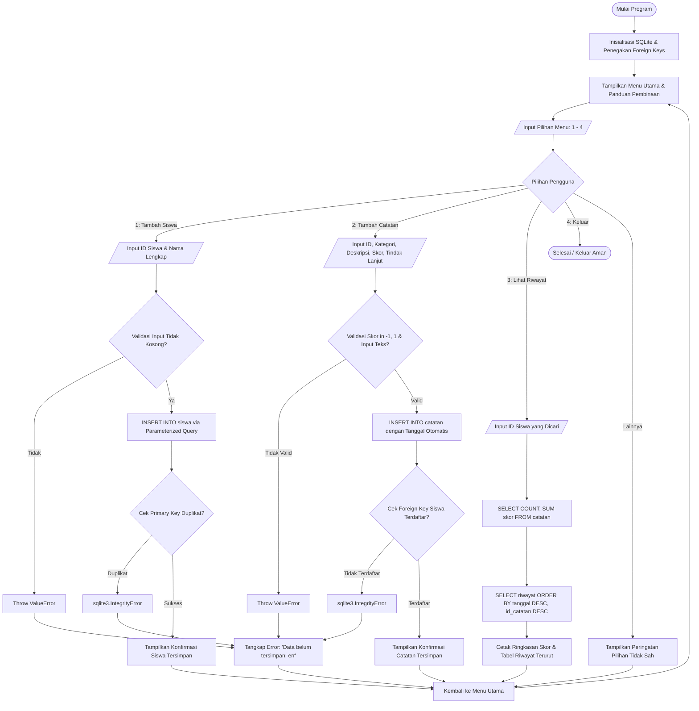
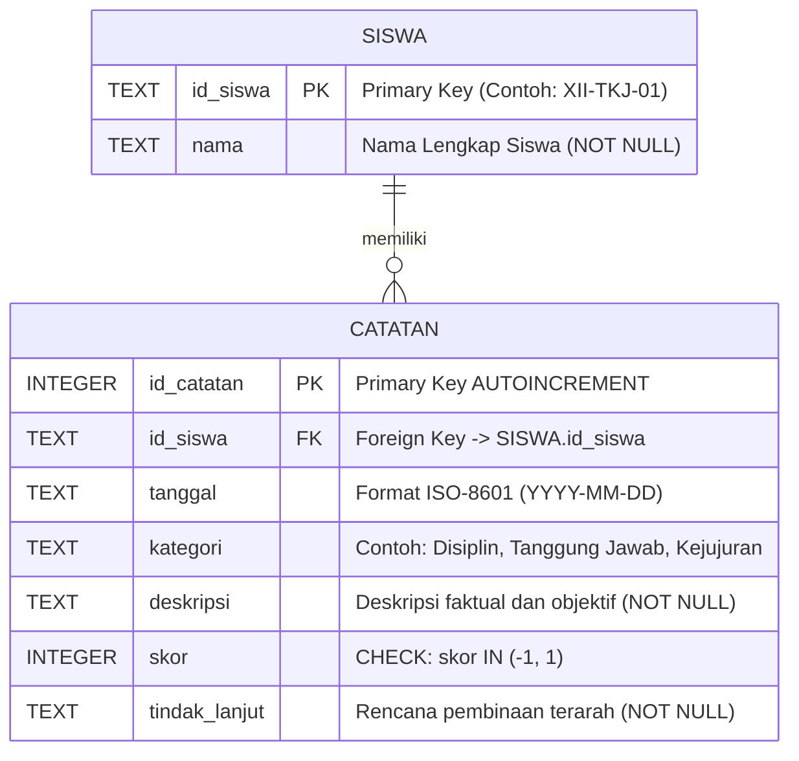

# Aplikasi Monitoring Akhlak Siswa (Kelas XII TKJ - SMK Alhadiid)

Aplikasi berbasis konsol Python murni (*zero external dependencies*) yang dirancang khusus untuk mendukung sistem pencatatan, pemantauan, dan pembinaan karakter siswa di lingkungan SMK Alhadiid, khususnya program keahlian Teknik Komputer dan Jaringan (TKJ).

Aplikasi ini menggunakan basis data lokal **SQLite3** dengan penegakan integritas relasional penuh (*Foreign Key constraints* & *CHECK constraints*), *parameterized queries* untuk keamanan maksimal, serta arsitektur kode modular yang kompatibel langsung di Spyder IDE maupun terminal Linux/macOS/Windows.

---

## 🎯 Tujuan Pembelajaran & Nilai Proyek

Proyek ini dirancang untuk memenuhi kompetensi kejuruan Kelas XII TKJ dalam bidang pemrograman sistem dan rekayasa data dasar:
1. **Pemrograman Python Robust & Defensif**: Membangun aplikasi konsol tanpa library pihak ketiga menggunakan modul standar `sqlite3` dan `datetime`.
2. **Integritas Basis Data Relasional**: Menerapkan relasi *One-to-Many* (1 Siswa memiliki banyak Catatan Pembinaan), pencegahan anomali data, dan eliminasi risiko data yatim (*orphaned records*).
3. **Keamanan Data**: Menggunakan *parameterized query* (`?`) untuk menangkal celah *SQL Injection*.
4. **Etika & Tata Kelola Pembinaan**: Menerapkan pendekatan pencatatan berbasis data faktual, berkeadilan, dan berorientasi pembinaan positif.

---

## 🧭 Prinsip Desain Pembinaan Siswa

Sistem ini didesain bukan sebagai instrumen penghakiman siswa, melainkan sebagai instrumen pendampingan perkembangan karakter:
1. **Mencatat Fakta yang Dapat Diamati**: Deskripsi perilaku wajib mencatat tindakan konkret (fakta observasi), bukan label personal atau praduga subjektif.
2. **Bahasa Netral & Profesional**: Menghindari kata-kata bernuansa menghakimi atau merendahkan martabat siswa.
3. **Ruang Klarifikasi & Tindak Lanjut**: Setiap catatan wajib disertai rencana aksi pembinaan yang terarah serta memberi ruang bagi siswa untuk berdialog.
4. **Skor Bukan Penentu Tunggal**: Skor `-1` (evaluasi/pembinaan) dan `+1` (apresiasi positif) hanya berfungsi sebagai indikator tren bimbingan pendidik, bukan penentu tunggal karakter apalagi nilai akademik rapor.

---

## 📊 Diagram Alur Sistem (Flowchart)



---

## 🗄️ Diagram Relasi Entitas (ERD)



---

## 🚀 Panduan Instalasi & Eksekusi

Aplikasi ini menggunakan pustaka standar Python 3 (`sqlite3` dan `datetime`), sehingga **tidak memerlukan `pip install` paket eksternal apapun**.

### 1. Menjalankan di Spyder IDE
1. Buka aplikasi **Spyder**.
2. Pilih menu `File` -> `Open...`, lalu pilih file `monitoring_akhlak.py`.
3. Klik tombol **Run File** (F5) atau tekan ikon segitiga hijau.
4. Antarmuka CLI interaktif akan langsung tampil pada panel **IPython Console** di Spyder.

### 2. Menjalankan di Terminal / Command Prompt
```bash
# Pastikan berada di direktori proyek
cd /path/ke/monitoring-akhlak-siswa-tkj

# Jalankan aplikasi utama
python3 monitoring_akhlak.py
```

### 3. Menjalankan Otomatisasi Pengujian 6 Skenario Wajib
Untuk memverifikasi keandalan sistem, validasi database, dan penanganan kesalahan:
```bash
python3 uji_skenario.py
```
Skrip uji akan otomatis melakukan simulasi dengan 100% data fiktif dan menghapus file database sementara setelah selesai.

---

## 📁 Struktur Direktori Proyek

```text
monitoring-akhlak-siswa-tkj/
├── .gitignore               # Proteksi database (*.db), cache, dan file sensitif
├── DOKUMENTASI_PROYEK.md    # Laporan 5 fase proyek, etika data, & 5 jawaban refleksi
├── README.md                # Dokumentasi arsitektur, panduan teknis, dan diagram
├── monitoring_akhlak.py     # Kode sumber utama aplikasi konsol & modul SQLite
└── uji_skenario.py          # Otomatisasi pengujian 6 skenario wajib & verifikasi
```

---

## 🛡️ Lisensi & Hak Cipta
Modul Proyek Praktik Kejuruan Kelas XII TKJ - SMK Alhadiid. Dikembangkan untuk tujuan edukasi dan pengembangan karakter siswa.
